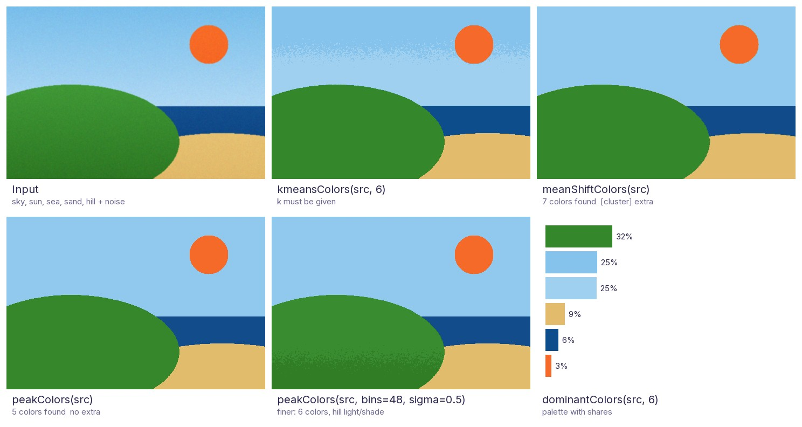
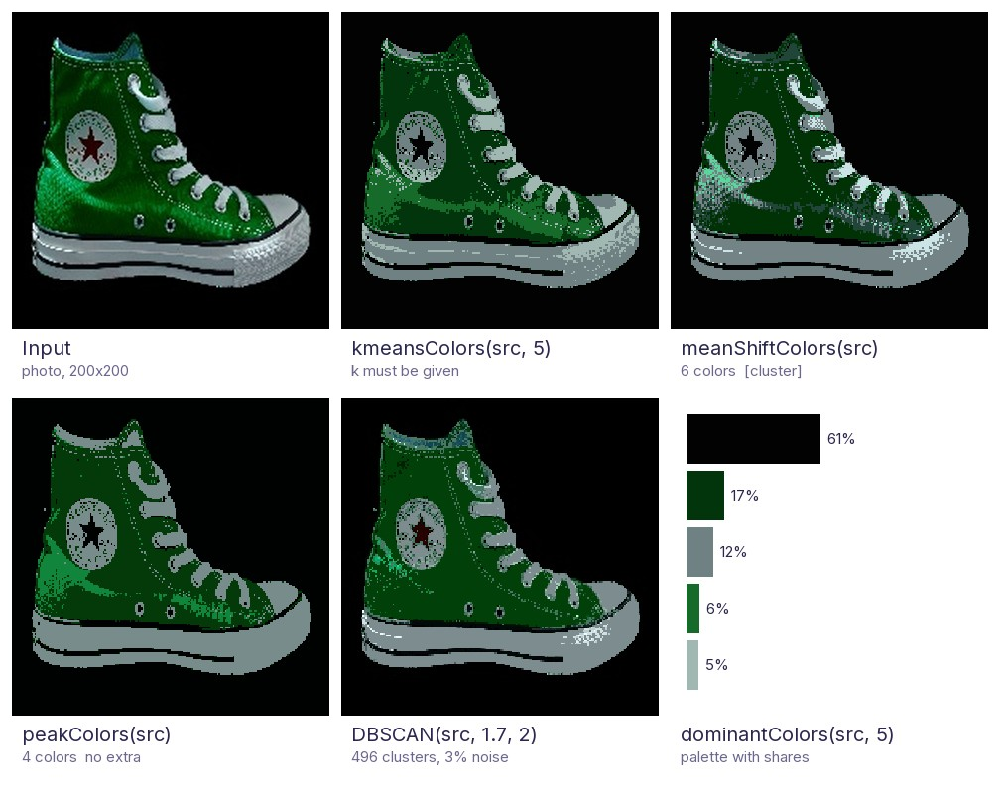

<p align="center">
  <picture>
    <source media="(prefers-color-scheme: dark)" srcset="https://raw.githubusercontent.com/076923/cv2-utils/main/images/brand/logo-dark.png">
    
  </picture>
</p>

<p align="center">
  <a href="https://pypi.org/project/python-opencv-utils/"></a>
  <a href="https://pypi.org/project/python-opencv-utils/"></a>
  <a href="https://github.com/076923/cv2-utils/actions/workflows/ci.yml"></a>
  <a href="https://076923.github.io/cv2-utils/"></a>
  
  <a href="https://github.com/076923/cv2-utils/blob/main/LICENSE"></a>
</p>

# Python OpenCV Utilities

Python OpenCV Utilities provides useful extensions for [OpenCV](https://opencv.org/)
and can be used as a **drop-in replacement for `cv2`**.

```python
import cv2u as cv  # instead of: import cv2 as cv
```

| | |
|---|---|
| PyPI package | `python-opencv-utils` |
| Import name | `cv2u` |
| Python | 3.11 – 3.15 |
| OpenCV | 4.10+ and 5.x, any distribution (normal, headless, contrib) |
| NumPy | 2.0+ |
| Documentation | <https://076923.github.io/cv2-utils/> |

## Installation

Choose the OpenCV distribution with an extra:

```bash
pip install "python-opencv-utils[opencv]"            # opencv-python
pip install "python-opencv-utils[headless]"          # opencv-python-headless (servers, Docker; no GUI)
pip install "python-opencv-utils[contrib]"           # opencv-contrib-python
pip install "python-opencv-utils[contrib-headless]"  # opencv-contrib-python-headless
pip install "python-opencv-utils[opencv,cluster]"    # also scikit-learn (meanShiftColors, DBSCAN, clusterPoints)
```

If the project already has OpenCV installed, `pip install python-opencv-utils` without an extra uses it.
Dependencies: OpenCV 4.10 or newer (including OpenCV 5), `numpy>=2`, `pillow`.
The optional `cluster` extra adds `scikit-learn` for `meanShiftColors`, `DBSCAN` and `clusterPoints`.
`dominantColors`, `colorQuantize` and `kmeansColors` work without it (they use `cv.kmeans`).

> [!NOTE]
> All OpenCV distributions provide the same `cv2` module and conflict with each other, so install only one of them.
> `import cv2u` raises an `ImportError` with these instructions if no `cv2` (or one older than 4.10) is found.
> On a headless build, `imshowEx` fails just like `cv.imshow`; everything else works.

## Usage

The [official OpenCV Python tutorials](https://docs.opencv.org/5.0/py_tutorials/py_tutorials.html) import the module as
`import cv2 as cv`. Use the same pattern with `cv2u`: every OpenCV function and constant keeps working,
and the extensions below are available alongside them.

```python
import cv2u as cv

src = cv.imread("image.jpg")  # plain OpenCV
dst = cv.rotateEx(src, 45)  # cv2u extension
```

If a name exists in both, the `cv2u` version wins. You can always reach the original module with `import cv2`.
`cv` is only a name, so `import cv2u as cv2` also works if you prefer it.

Type checkers and IDEs see OpenCV's own signatures through `cv2u`, so autocompletion and type checking for
`cv.imread` and friends keep working. Names the OpenCV 5.0 stubs do not have (added later, or only in OpenCV 4) are typed as `Any`.

### Everyday helpers

```python
import cv2u as cv

src = cv.imreadEx("C:/사진/고양이.jpg")  # cv.imread fails on non-ASCII paths on Windows
small = cv.resizeEx(src, width=640)  # keeps the aspect ratio
boxed, scale, (left, top) = cv.letterbox(src, (640, 640))  # fit + pad, e.g. for a model input
logo = cv.imread("logo.png", cv.IMREAD_UNCHANGED)  # BGRA with transparency
stamped = cv.overlayImage(small, logo, org=(10, 10), opacity=0.8)
cv.imwriteEx("C:/사진/비교.png", cv.hconcatEx([small, stamped], gap=8))
```

### Video and notebooks

```python
import cv2u as cv

print(cv.videoInfo("input.mp4"))  # VideoInfo(width=1920, height=1080, fps=30.0, frameCount=900)
edges = (cv.autoCanny(frame) for frame in cv.readFrames("input.mp4", step=2))  # every 2nd frame
cv.writeVideo("edges.mp4", edges, fps=15)  # codec, size and color mode are detected

corners = [[120, 80], [980, 140], [940, 760], [90, 700]]  # e.g. from cv.approxPolyDP, in any order
page = cv.fourPointTransform(cv.imread("photo.jpg"), corners)
cv.imshowInline(page)  # in Jupyter, with the correct colors
```

### Detection and web results

```python
import cv2u as cv

img = cv.imread("street.jpg")
detections = [((40, 60, 120, 200), "person", 0.94), ((200, 90, 160, 110), "자동차", 0.88)]
crops = []
for box, name, score in detections:
    crops.append(cv.cropEx(img, box, margin=10, fill=0))  # safe even at the image border
    cv.drawLabel(img, box, f"{name} {score:.2f}", (0, 200, 255), fontPath="C:/Windows/Fonts/malgun.ttf")

hsv = cv.cvtColor(img, cv.COLOR_BGR2HSV)
red = cv.inRangeEx(hsv, (170, 80, 80), (10, 255, 255))  # red wraps around hue 0
cv.imwrite("result.png", cv.montage([img, cv.overlayMask(img, red, (255, 0, 255)), *crops], gap=8))

payload = {"image": cv.imencodeBase64(img, ".jpg", dataUri=True)}  # for a JSON API or an HTML 
```

Raw detector output to clean boxes on the original image:

```python
import cv2u as cv

img = cv.imread("street.jpg")
small, scale, offset = cv.letterbox(img, (640, 640))  # what the network saw
boxes, scores = run_model(small)  # (N, 4) as (x, y, w, h) and (N,)
keep = cv.nms(boxes, scores, iouThreshold=0.5, scoreThreshold=0.3)
boxes = cv.scaleBoxes(boxes[keep], scale, offset, inverse=True)  # back to the original image
boxes = cv.clipBoxes(cv.expandBoxes(boxes, ratio=0.1), (img.shape[1], img.shape[0]))
cv.drawBoxes(img, boxes, labels=[f"{s:.2f}" for s in scores[keep]])  # one color per box

mask = cv.morphology(cv.binarize(img, "adaptive", invert=True), "open", 5)  # dark ink, speckles removed
heat = cv.mapTiles(img, (512, 512), run_model, overlap=32)  # a fixed-input model over a big image, seams averaged
images = cv.imreadAll(cv.listImages("photos/"))  # a folder in natural order; a bad file raises with its name
lines = cv.findLines(img, minLength=100)  # (N, 4) segments, longest first
aligned, M = cv.alignImages(cv.imread("scan.png"), cv.imread("template.png"))  # feature match + RANSAC + warp
```

### rotateEx

Rotates an image without cropping its corners. The canvas grows to fit the result.

```python
import cv2u as cv

src = cv.imread("image.jpg")
dst = cv.rotateEx(src, 45)

cv.imshow("src", src)
cv.imshow("dst", dst)
cv.waitKey()
```

| src | dst |
|:---:|:---:|
|  |  |

### Masks, contours and templates

```python
import cv2u as cv

scan = cv.cropToContent(cv.imread("scan.png"), tolerance=10)  # drop the white margin
mask = cv.inRange(cv.toGray(scan), 0, 100)  # dark ink; toGray works whatever the input is
mask = cv.fillHoles(cv.removeSmallObjects(mask, minArea=30))
contours = cv.findContoursEx(mask, minArea=500)  # largest first
round_ones = cv.filterContours(contours, minCircularity=0.8)  # by area, aspect ratio, solidity, ...
for i, contour in enumerate(cv.sortContours(round_ones, "left-to-right")):
    stats = cv.contourStats(contour)  # area, perimeter, rect, center, solidity, circularity, ...
    cv.drawLabel(scan, stats.rect, f"{i}: {stats.area:.0f} px", (0, 160, 255))
    cv.imwriteEx(f"out/piece_{i}.png", cv.cropContour(scan, contour, transparent=True), makeDirs=True)
debug = cv.drawContoursEx(scan, contours, labels=True)  # each contour in its own color, numbered

for x, y, w, h, score in cv.findTemplate(scan, cv.imread("logo.png"), threshold=0.9):
    print(f"logo at ({x}, {y}), score {score:.2f}")
cv.imwriteEx("out/annotated.png", scan, makeDirs=True)  # cv.imwrite would return False: no "out" folder
```

### Color clustering



Every color clustering returns `(maps, centers)`: a label image and one color per label, so `centers[maps]` paints
the result. They differ in how the number of colors is chosen:

| | `kmeansColors` | `meanShiftColors` | `peakColors` |
|---|---|---|---|
| Number of colors | You give `k` | Found automatically | Found automatically |
| Needs the `[cluster]` extra | No | Yes | No |
| Deterministic | Yes (`seed`) | Yes (`seed`) | Yes (no randomness at all) |
| Pixels used to fit | A sample | A sample | Every pixel |
| 1 MP / 12 MP image | 0.25 s / 3.0 s | 0.53 s / 2.7 s | **0.13 s / 1.5 s** |

*Timings: the scene above at 1200x800 and 4200x2800, best of 3 runs, on one Windows PC with Python 3.14;
use them to compare the methods, not as absolute numbers.*

`peakColors` is cv2u's own method: it counts the pixels in a 3-D Lab color histogram, smooths it, and follows every
histogram cell uphill to its peak; each peak becomes one color. Identical colors, which are very common in 8-bit
images, simply add up, so it neither needs a sample nor splits flat colors apart. In the comparison it found the
5 regions of the scene, where `kmeansColors` (with a fixed `k=6`) cut the sky gradient with a noisy band, and
`meanShiftColors` added two clusters of 421 and 79 pixels. `bins` and `sigma` make it finer or coarser, and
`minRegion` absorbs small speckles into the surrounding region.



On a real photo of a sneaker, `peakColors` separates background, the dark and bright
greens and the white parts into 4 clean regions. `meanShiftColors` finds 6 colors but leaves the surface
speckled, and `DBSCAN` with `eps=1.7` splits the image into 496 tiny clusters, which mostly reproduces the input.
Note that the dark-red star (15 pixels, 0.04% of the image, almost black) merges into the background with every
color clustering except that very fine `DBSCAN`; details this small are below what a palette can keep.

```python
import cv2u as cv

img = cv.imread("photo.jpg")
maps, centers = cv.peakColors(img)  # number of colors found automatically, no extra needed
print(len(centers), "colors")
segmented = centers[maps]

for (b, g, r), share in cv.dominantColors(img, k=5):  # a palette
    print(f"#{r:02x}{g:02x}{b:02x} {share:.0%}")
poster = cv.colorQuantize(img, 8)
```

### Named flags

```python
import cv2u as cv

src = cv.imread("image.jpg")
mirrored = cv.flip(src, cv.FLIP_MODE_Y)  # instead of cv.flip(src, 1)
edges = cv.Sobel(src, cv.DDEPTH_SAME, 1, 0)  # instead of ddepth=-1
gray = cv.cvtColor(src, cv.COLOR_BGR2GRAY)
contours, _ = cv.findContours(cv.Canny(gray, 100, 200), cv.RETR_EXTERNAL, cv.CHAIN_APPROX_SIMPLE)
cv.drawContours(src, contours, cv.ALL_CONTOURS, (0, 255, 0), cv.FILLED)  # instead of contourIdx=-1

cv.imshow("mirrored", mirrored)
while cv.waitKey(cv.WAIT_FOREVER) != cv.KEY_ESC:  # instead of waitKey(0) != 27
    pass
```

## Design principles

cv2u is *what you wish OpenCV had, in the place you would look for it*:

1. **Fill the gaps in OpenCV**: only add what OpenCV lacks or makes you write boilerplate for.
2. **Look like OpenCV**: same module names, camelCase, `Ex` for extended versions, `src` first, BGR, OpenCV parameter names.
3. **Never shadow OpenCV**: no extension has the same name as anything in `cv2`.
4. **Stay light**: heavier dependencies are optional extras.
5. **Typed and validated**: type hints everywhere, clear `ValueError`s for bad input.
6. **Change carefully**: after a release, renames get deprecated aliases and new behavior goes behind new parameters.

Details: <https://076923.github.io/cv2-utils/principles/>

## API

Full reference with parameters and exceptions: <https://076923.github.io/cv2-utils/api/>

### core

| Function | Description |
|---|---|
| `rotateEx(src, angle, scale=1.0, flags=None, borderMode=None, borderValue=None)` | Rotate around the center without cropping. Extra arguments go to `cv.warpAffine`. |
| `centerPoint(contour)` | Centroid `(x, y)` of a contour. Raises `ValueError` for zero area. |
| `isInside(p, polygon)` | Point-in-polygon test. `polygon` is `(N, 1, 2)` or `(N, 2)`. |
| `cartesianToPolar(x, y, angleInDegrees=False)` | Returns `(theta, rho)` for scalars or arrays. Note: `cv.cartToPolar` returns `(magnitude, angle)`. |
| `polarToCartesian(theta, rho, angleInDegrees=False)` | Returns `(x, y)` for scalars or arrays. |
| `imcolor(shape, color, dtype=np.uint8)` | Image filled with `color`. |
| `imcolorLike(src, color, dtype=None)` | Image with the shape (and dtype) of `src`, filled with `color`. |
| `makeGradient(shape, start, end, direction="horizontal")` | Linear gradient image. `direction` is `"horizontal"`, `"vertical"` or `"raster"`. |
| `gammaCorrection(src, gamma=1.0)` | Gamma correction for 8-bit images through a lookup table. |
| `DHEdge(src)` | Edge enhancement for single-channel 8-bit images. |
| `dominantColors(src, k=5)` | The `k` most common colors with their share, most common first (a palette). |
| `colorQuantize(src, k)` | Reduce the image to `k` colors. |
| `kmeansColors(src, k, seed=0)` | Deterministic color k-means in Lab space. Returns `(maps, centers)`. |
| `peakColors(src, bins=32, sigma=0.75, minShare=0.01, minRegion=0)` | Finds the number of colors itself from the peaks of the color histogram. Fast, deterministic, no extra. |
| `meanShiftColors(src, bandwidth=None)` | Like `kmeansColors`, but finds the number of colors itself. Needs `[cluster]`. |
| `DBSCAN(src, eps, minSamples)` | Cluster BGR pixels in Lab space. Returns `(maps, labels)`. Noise is `0`. Needs `[cluster]`. |
| `drawDBSCAN(src, maps, labels)` | Paint each cluster with its mean color. |
| `clusterPoints(points, eps, minSamples=2)` | Group nearby points (keypoints, detections, ...) with DBSCAN. Needs `[cluster]`. |
| `hconcatEx(images, color=0, gap=0)` | Side by side, for images of different heights and channels. |
| `vconcatEx(images, color=0, gap=0)` | Stacked vertically, for images of different widths and channels. |
| `overlayImage(src, overlay, org=(0, 0), opacity=1.0)` | Alpha-blend a (transparent) image onto another, clipped at the borders. |
| `montage(images, cols=None, gap=0, color=0, cellSize=None)` | Arrange images in a grid. |
| `cropEx(src, rect, margin=0, fill=None)` | Crop safely when the box extends outside the image (clip, or pad with `fill`). |
| `boxIoU(boxesA, boxesB)` | IoU of every pair of boxes `(x, y, w, h)`, as an `(N, M)` array. |
| `nms(boxes, scores, iouThreshold=0.5, scoreThreshold=0, maxCount=None)` | Non-maximum suppression; the indices to keep, best first. |
| `xywhToXyxy(boxes)`, `xyxyToXywh(boxes)` | Convert between `(x, y, w, h)` and corner boxes. |
| `clipBoxes(boxes, size)`, `scaleBoxes(boxes, scale, offset=(0, 0), inverse=False)`, `expandBoxes(boxes, ratio=0, pixels=0, size=None)` | Clip to the image, undo a resize or letterbox, grow for context. |
| `centerCrop(src, size, fill=None)` | Crop `(width, height)` from the middle. |
| `inRangeEx(src, lowerb, upperb)` | `cv.inRange` for HSV hue ranges that wrap around, such as red (170 to 10). |
| `cropToContent(src, background=None, tolerance=0, margin=0)` | Trim a uniform border (scan margins, black bars). |
| `padToMultiple(src, multiple, color=0)`, `padToSize(src, size, color=0)` | Pad to a multiple (e.g. 32 for networks) or to an exact size, without scaling. |
| `splitTiles(src, tileSize, overlap=0)`, `mergeTiles(tiles, size)` | Split a large image into full-size tiles and merge processed tiles back (overlaps averaged). |
| `mapTiles(src, tileSize, func, overlap=0, progress=None)` | Run a function (e.g. a model) over a large image tile by tile and merge the results. |

### imgcodecs

| Function | Description |
|---|---|
| `imreadEx(filename, flags=cv.IMREAD_COLOR)` | `cv.imread` that also works with non-ASCII (e.g. Korean) paths on Windows. |
| `imwriteEx(filename, img, params=(), makeDirs=False)` | `cv.imwrite` that also works with non-ASCII paths on Windows, and can create missing folders. |
| `listImages(path, recursive=False)` | The image files in a folder, in natural order (`img2` before `img10`). |
| `imreadAll(filenames, flags=cv.IMREAD_COLOR, strict=True)`, `imwriteAll(filenames, images, params=(), makeDirs=False, strict=True)` | Read or write many files; unreadable files raise with the file name (or give `None`). |
| `urlread(url, flags=cv.IMREAD_UNCHANGED, timeout=None, headers=None, maxBytes=None)` | Read an image from a URL. Returns `None` if decoding fails, like `cv.imread`. |
| `toPillow(src)`, `fromPillow(image)` | Convert to/from Pillow with the right channel order. Every Pillow mode is accepted; 16-bit, `int32`, `float32` and `bool` images round-trip unchanged. |
| `imencodeBase64(img, ext=".png", dataUri=False)`, `imdecodeBase64(data)` | Images as base64 text or data URIs, e.g. for web APIs. |

### imgproc

| Function | Description |
|---|---|
| `adjustBrightnessContrast(src, brightness=0, contrast=1.0)` | Brightness/contrast like a photo editor (contrast pivots around mid-gray). |
| `adjustHSV(src, hue=0, saturation=1.0, value=1.0)` | Rotate the hue (degrees) and scale saturation/brightness. |
| `autoContrast(src, clip=0.01)`, `whiteBalance(src)` | Auto levels that ignore outliers; remove a color cast. |
| `sharpnessScore(src)`, `ssim(a, b)`, `diffMask(a, b, threshold=25)` | Blur detection, structural similarity, changed pixels. |
| `imageHash(src, hashSize=8, method="difference")`, `hashDistance(a, b)` | Perceptual hashes (dHash, aHash, pHash) for finding near-duplicate images. |
| `matchHistograms(src, reference)`, `colorTransfer(src, reference)` | Give an image the tones or the color mood of another one. |
| `translate(src, dx, dy)` | Shift an image, keeping its size. |
| `transformPoints(points, M)` | Map points through a 2x3 affine or 3x3 perspective matrix, in any point layout. |
| `cropRotatedRect(src, rect)` | Cut out a rotated box from `cv.minAreaRect` as an upright image. |
| `deskew(src, maxAngle=45.0)` | Straighten a tilted page from its text lines. Returns `(dst, angle)`. |
| `pixelate(src, blockSize=16, rect=None)` | Mosaic the image or one box, e.g. to anonymize faces. |
| `drawDashedLine(img, pt1, pt2, color)`, `drawDashedRectangle(img, rect, color)` | Dashed lines and boxes, in place. |
| `drawRoundedRectangle(img, rect, color, thickness=1, lineType=cv.LINE_8, radius=8)` | A box with rounded corners, in place. |
| `drawHistogram(src, size=(512, 200))` | Plot the histogram as an image. |
| `largestComponent(mask)`, `skeletonize(mask)`, `cutout(src, mask, feather=0)` | Keep the main object, thin to 1-pixel lines, cut out with transparency. |
| `hexToBGR("#ff8800")`, `bgrToHex(color)` | Convert between hex colors and BGR tuples. |
| `toGray(src)`, `toBGR(src)`, `toBGRA(src, alpha=None)` | Convert from any channel count; no error when the image is already in that format. |
| `flattenAlpha(src, background=(255, 255, 255))` | Composite a transparent image onto a color or image, e.g. before saving as JPEG. |
| `findContoursEx(image, mode=cv.RETR_EXTERNAL, method=cv.CHAIN_APPROX_SIMPLE, minArea=0, sort=True)` | `cv.findContours` for any image, largest first, small ones dropped. |
| `binarize(src, method="otsu", invert=False)` | Any image to a 0/255 mask: Otsu, adaptive, triangle or a fixed threshold. |
| `morphology(src, op, ksize=3, shape="ellipse", iterations=1)` | `cv.morphologyEx` by name (`"open"`, `"close"`, ...) with the kernel built for you. |
| `maskBoundingRect(mask)`, `applyMask(src, mask, background=0)` | Box of the nonzero pixels; keep the masked pixels, fill the rest. |
| `findLines(src, minLength=30, maxGap=10)`, `findCircles(src, minRadius=0, maxRadius=0)`, `detectBlobs(src, minArea=10)` | Hough lines and circles and blob detection as plain `(N, 4)` / `(N, 3)` arrays. |
| `matchFeatures(src, dst, method="ORB", ratio=0.75)`, `alignImages(src, reference, motion="homography")` | Keypoint matching with the ratio test; register one image onto another. |
| `fillHoles(mask, maxHoleArea=None)`, `removeSmallObjects(mask, minArea)` | Mask clean-up. |
| `contourStats(contour)` | Area, perimeter, rect, center, aspect ratio, extent, solidity, circularity, equivalent diameter and orientation in one named tuple. |
| `sortContours(contours, method="left-to-right")`, `filterContours(contours, minArea=0, ..., minCircularity=0)` | Reading order or size order; keep the shapes whose measurements are in range. |
| `contoursToMask(contours, size)`, `cropContour(src, contour, margin=0, background=0, transparent=False)` | Contours back to a mask; crop one object with the outside blanked or transparent. |
| `approxContour(contour, epsilon=0.02)`, `mergeContours(contours)` | `cv.approxPolyDP` with a relative tolerance; one hull around several pieces. |
| `drawContoursEx(src, contours, labels=False)`, `boundingRects(contours)`, `asContour(points)` | Each contour in its own color with labels; all boxes as an `(N, 4)` array; points to an OpenCV contour. |
| `findTemplate(src, templ, threshold=0.8, maxCount=None)` | `cv.matchTemplate` as a list of non-overlapping matches `(x, y, w, h, score)`. |
| `resizeEx(src, width=None, height=None, interpolation=None)` | Resize keeping the aspect ratio; picks `INTER_AREA`/`INTER_LINEAR` automatically. |
| `letterbox(src, size, color=0, interpolation=None)` | Fit into `(width, height)` keeping the aspect ratio and pad. Returns `(dst, scale, (left, top))`. |
| `fourPointTransform(src, pts, size=None)` | Warp a quadrilateral (corners in any order) to an upright rectangle, e.g. a photographed document. |
| `autoCanny(src, sigma=0.33)` | `cv.Canny` with thresholds chosen from the median brightness. |
| `equalizeHistEx(src, clahe=False)` | `cv.equalizeHist` for color images too (on the Lab lightness), optionally CLAHE. |
| `unsharpMask(src, sigma=1.0, amount=1.0, threshold=0)` | Unsharp-mask sharpening. |
| `drawLabel(img, rect, text, color, fontPath=None)` | Draw a box with a label tag, in place like `cv.rectangle`. Unicode labels with `fontPath`. |
| `overlayMask(src, mask, color=(0, 0, 255), alpha=0.5)` | Tint the masked pixels, e.g. to show a segmentation. |
| `drawBoxes(img, boxes, labels=None, colors=None)`, `drawPoints(img, points, labels=False)`, `drawGrid(img, step)` | Many boxes or points at once, each in its own color; a pixel grid. |
| `distinctColors(count)` | BGR colors that are easy to tell apart, for classes, tracks or clusters. |
| `putTextEx(src, text, org, fontPath, fontSize, color)` | Draw Unicode text (e.g. Korean) with a TrueType font. `org` is the top-left corner. |

### videoio

| Function | Description |
|---|---|
| `readFrames(source, step=1, start=0)` | Iterate over the frames of a file, stream or camera; the capture is released automatically. |
| `writeVideo(filename, frames, fps, fourcc=None)` | Write frames; size, color mode and codec (from the extension) are detected. Returns the frame count. |
| `readFrameAt(source, index=None, seconds=None)` | Read one frame by number or time, e.g. for a thumbnail. |
| `videoInfo(source)` | `VideoInfo(width, height, fps, frameCount)` with a `duration` property. |

### highgui

| Function | Description |
|---|---|
| `imshowInline(img, maxSize=None)` | Show an image in a Jupyter notebook, in its real colors (no BGR/RGB mix-up). |
| `imshowEx(winname, img, maxSize=(1280, 720))` | `cv.imshow` that shrinks images larger than the screen. |

### flag

Named constants for magic numbers that OpenCV takes without a constant of its own.

| Constant | Value | Use |
|---|---|---|
| `FLIP_MODE_X`, `FLIP_MODE_Y`, `FLIP_MODE_XY` | `0`, `1`, `-1` | `cv.flip(src, flipCode)` |
| `DDEPTH_SAME` | `-1` | `ddepth` of `cv.filter2D`, `cv.Sobel`, ...: same depth as the source |
| `ALL_CONTOURS` | `-1` | `contourIdx` of `cv.drawContours` |
| `REDUCE_TO_ROW`, `REDUCE_TO_COL` | `0`, `1` | `dim` of `cv.reduce` |
| `WAIT_FOREVER` | `0` | `delay` of `cv.waitKey` |
| `KEY_ESC`, `KEY_ENTER`, `KEY_SPACE`, `KEY_TAB`, `KEY_BACKSPACE` | `27`, `13`, `32`, `9`, `8` | Return value of `cv.waitKey` |

## Development

See [CONTRIBUTING.md](CONTRIBUTING.md). Release notes are in [CHANGELOG.md](CHANGELOG.md).
Please follow the [Code of Conduct](CODE_OF_CONDUCT.md), and report security issues as described in [SECURITY.md](SECURITY.md).
To cite this project, use [CITATION.cff](CITATION.cff) (GitHub shows a "Cite this repository" button).

## Authors

Daehee Yun (s076923@gmail.com)

## License

[Apache License 2.0](LICENSE)
