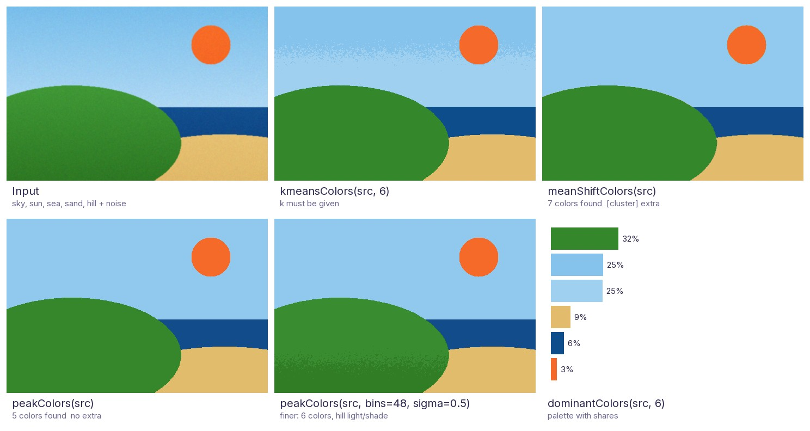
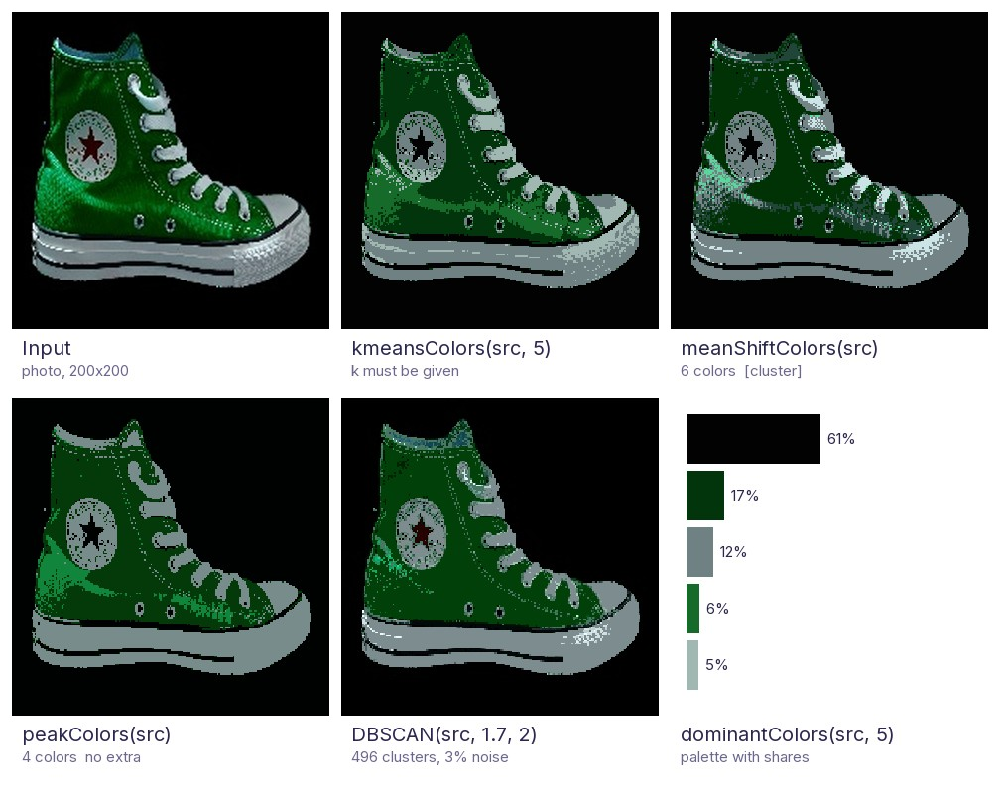

# Python OpenCV Utilities

Useful extensions for [OpenCV](https://opencv.org/) that you can use as a **drop-in replacement for `cv2`**.

```python
import cv2u as cv  # instead of: import cv2 as cv

src = cv.imread("image.jpg")  # plain OpenCV
dst = cv.rotateEx(src, 45)  # cv2u extension
```

## Installation

Choose the OpenCV distribution with an extra:

```bash
pip install "python-opencv-utils[opencv]"            # opencv-python
pip install "python-opencv-utils[headless]"          # opencv-python-headless (servers, Docker; no GUI)
pip install "python-opencv-utils[contrib]"           # opencv-contrib-python
pip install "python-opencv-utils[contrib-headless]"  # opencv-contrib-python-headless
pip install "python-opencv-utils[opencv,cluster]"    # also scikit-learn (meanShiftColors, dbscanColors, clusterPoints)
```

If the project already has OpenCV installed, `pip install python-opencv-utils` without an extra uses it.
The optional `cluster` extra adds `scikit-learn` for `meanShiftColors`, `dbscanColors` and `clusterPoints`.

| | |
|---|---|
| Python | 3.11 – 3.15 |
| OpenCV | 4.10+ and 5.x, any distribution (normal, headless, contrib) |
| NumPy | 2.0+ |

!!! note "One OpenCV distribution per environment"
    All OpenCV distributions provide the same `cv2` module and conflict with each other, so install only one of them.
    `import cv2u` raises an `ImportError` with these instructions if no `cv2` (or one older than 4.10) is found.
    On a headless build, `imshowEx` fails just like `cv.imshow`; everything else works.

## How it works

The [official OpenCV Python tutorials](https://docs.opencv.org/5.0/py_tutorials/py_tutorials.html) import the module
as `import cv2 as cv`. `cv2u` follows the same pattern:

- Every attribute that `cv2u` does not define is looked up on `cv2` at runtime, so `cv.imread`,
  `cv.COLOR_BGR2GRAY`, `cv.dnn` and so on work as usual.
- Type checkers and IDEs see OpenCV's own signatures too, so autocompletion and type checking keep working.
  Names added in OpenCV releases newer than 5.0 are typed as `Any`.
- If a name exists in both, the `cv2u` version wins. The original module is always available with `import cv2`.

## Examples

### Everyday helpers

```python
import cv2u as cv

src = cv.imreadEx("C:/사진/고양이.jpg")  # cv.imread fails on non-ASCII paths on Windows
small = cv.resizeEx(src, width=640)  # keeps the aspect ratio
boxed, scale, (left, top) = cv.letterbox(src, (640, 640))  # fit + pad, e.g. for a model input
logo = cv.imread("logo.png", cv.IMREAD_UNCHANGED)  # BGRA with transparency
stamped = cv.overlayImage(small, logo, org=(10, 10), alpha=0.8)
cv.imwriteEx("C:/사진/비교.png", cv.hconcatEx([small, stamped], gap=8))
```

### Video and notebooks

```python
import cv2u as cv

print(cv.videoInfo("input.mp4"))  # VideoInfo(width=1920, height=1080, fps=30.0, frameCount=900)
edges = (cv.autoCanny(frame) for frame in cv.readFrames("input.mp4", step=2))  # every 2nd frame
cv.writeVideo("edges.mp4", edges, fps=15)  # codec, size and color mode are detected

corners = [[120, 80], [980, 140], [940, 760], [90, 700]]  # e.g. from cv.approxPolyDP, in any order
page = cv.fourPointTransform(cv.imread("photo.jpg"), corners)
cv.imshowInline(page)  # in Jupyter, with the correct colors
```

### Detection and web results

```python
import cv2u as cv

img = cv.imread("street.jpg")
detections = [((40, 60, 120, 200), "person", 0.94), ((200, 90, 160, 110), "자동차", 0.88)]
crops = []
for box, name, score in detections:
    crops.append(cv.cropRect(img, box, margin=10, fill=0))  # safe even at the image border
    cv.drawLabel(img, box, f"{name} {score:.2f}", (0, 200, 255), fontPath="C:/Windows/Fonts/malgun.ttf")

hsv = cv.cvtColor(img, cv.COLOR_BGR2HSV)
red = cv.inRangeEx(hsv, (170, 80, 80), (10, 255, 255))  # red wraps around hue 0
cv.imwrite("result.png", cv.montage([img, cv.overlayMask(img, red, (255, 0, 255)), *crops], gap=8))

payload = {"image": cv.imencodeBase64(img, ".jpg", dataUri=True)}  # for a JSON API or an HTML 
```

### Training data

```python
import cv2u as cv

img = cv.imread("train/0001.jpg")
size = (img.shape[1], img.shape[0])
boxes, classIds = cv.readYoloLabels("train/0001.txt", size)  # normalized rows -> pixel (x, y, w, h)
img, boxes = cv.randomFlip(img, horizontal=0.5, boxes=boxes, seed=1)  # the boxes follow the image
img, boxes = cv.randomRotate(img, maxAngle=10, boxes=boxes, seed=1)
img = cv.randomHSV(cv.addNoise(img, "gaussian", seed=1), hue=10, seed=1)
cv.writeYoloLabels("aug/0001.txt", boxes, classIds, size, makeDirs=True)
cv.imwriteEx("aug/0001.jpg", cv.jpegArtifacts(img, quality=40))

tiles = cv.imreadAll(["train/0001.jpg", "train/0002.jpg", "train/0003.jpg", "train/0004.jpg"])
labels = [cv.readYoloLabels(f"train/{i:04d}.txt", (t.shape[1], t.shape[0]))[0] for i, t in enumerate(tiles, 1)]
big, bigBoxes = cv.mosaic(tiles, (640, 640), boxes=labels, seed=1)  # YOLO-style 4-image mosaic
polygons = cv.maskToPolygons(cv.binarize(img, "otsu", invert=True))  # COCO polygons from a mask
rle = cv.rleEncode(cv.polygonsToMask(polygons, size))  # and uncompressed RLE, no pycocotools needed
```

### Running a model

```python
import cv2u as cv

net = cv.dnn.loadModel("C:/모델/yolov8n.onnx")  # Unicode path; FileNotFoundError instead of a C++ assertion
names = cv.dnn.readClassNames("coco.names")
img = cv.imread("street.jpg")
blob, info = cv.dnn.preprocessImage(img, (640, 640))  # letterbox + blob; info remembers the geometry
output = cv.dnn.inferImage(net, blob)[0]  # every output layer, not just the first
dets = cv.dnn.postprocessDetections(
    output, info, scoreThreshold=0.3
)  # YOLO rows -> Detections(boxes, scores, classIds)
cv.imwrite("result.png", cv.dnn.drawDetections(img, dets, names))  # boxes on the original image
```

Everything else in `cv.dnn` (`cv.dnn.readNet`, `cv.dnn.blobFromImage`, `cv.dnn.NMSBoxes`, ...) is passed through from OpenCV.

### Video tools

```python
import cv2u as cv

fps = cv.FPSCounter()
with cv.VideoReader("input.mp4") as video, cv.VideoWriterEx("out.mp4", fps=video.fps) as writer:
    video.seekTime(5.0)  # start at 00:05
    for frame in video:
        fps.tick()
        writer.write(cv.drawFPS(cv.autoCanny(frame), fps.fps))  # codec, size and color mode from the first frame

cuts = cv.detectScenes("input.mp4", threshold=30)  # frame indices where a new shot starts
print([cv.formatTimestamp(cv.frameToTime(i, video.fps)) for i in cuts])  # "00:00:12.400", ...
cv.extractFrames("input.mp4", "frames/", step=30, ext=".png")  # one file every 30 frames
cv.videoToGif("input.mp4", "preview.gif", fps=10, size=(320, 180), maxFrames=50)
cv.imwrite("sheet.jpg", cv.videoThumbnail("input.mp4", count=6, cols=3))  # contact sheet
```

### Documents and quality

```python
import cv2u as cv

photo = cv.imread("receipt.jpg")
page = cv.scanDocument(photo)  # detect the page, warp it upright, clean the background
mask = cv.sauvolaThreshold(page, invert=True)  # local threshold for OCR, no contrib module needed
for x, y, w, h in cv.detectTextLines(page):  # one box per text line, top to bottom
    cv.drawDashedRectangle(page, (x, y, w, h), (0, 160, 255))

stats = cv.imageStats(photo)  # ImageStats(width, height, channels, dtype, mean, std, ..., sharpness, entropy, isGray)
if cv.isBlurry(photo) or cv.isBlank(photo):
    print("retake:", stats.sharpness, stats.contrast)
cv.imwrite("compare.png", cv.compareImages(photo, page, mode="side", labels=["photo", "scan"]))
```

### rotateEx

Rotates an image without cropping its corners. The canvas grows to fit the result.

```python
import cv2u as cv

src = cv.imread("image.jpg")
dst = cv.rotateEx(src, 45)
```

| src | dst |
|:---:|:---:|
|  |  |

### Masks, contours and templates

```python
import cv2u as cv

scan = cv.cropToContent(cv.imread("scan.png"), tolerance=10)  # drop the white margin
mask = cv.inRange(cv.toGray(scan), 0, 100)  # dark ink; toGray works whatever the input is
mask = cv.fillHoles(cv.removeSmallObjects(mask, minArea=30))
for contour in cv.findContoursEx(mask, minArea=500)[:3]:  # the 3 largest shapes
    cv.drawLabel(scan, cv.boundingRect(contour), f"{cv.contourArea(contour):.0f} px", (0, 160, 255))

for x, y, w, h, score in cv.findTemplate(scan, cv.imread("logo.png"), threshold=0.9):
    print(f"logo at ({x}, {y}), score {score:.2f}")
cv.imwriteEx("out/annotated.png", scan, makeDirs=True)  # cv.imwrite would return False: no "out" folder
```

### Color clustering



Every color clustering returns `(maps, centers)`: a label image and one color per label, so `centers[maps]` paints
the result. They differ in how the number of colors is chosen:

| | `kmeansColors` | `meanShiftColors` | `peakColors` |
|---|---|---|---|
| Number of colors | You give `k` | Found automatically | Found automatically |
| Needs the `[cluster]` extra | No | Yes | No |
| Deterministic | Yes (`seed`) | Yes (`seed`) | Yes (no randomness at all) |
| Pixels used to fit | A sample | A sample | Every pixel |
| 1 MP / 12 MP image | 0.25 s / 3.0 s | 0.53 s / 2.7 s | **0.13 s / 1.5 s** |

*Timings: the scene above at 1200x800 and 4200x2800, best of 3 runs, on one Windows PC with Python 3.14;
use them to compare the methods, not as absolute numbers.*

`peakColors` is cv2u's own method: it counts the pixels in a 3-D Lab color histogram, smooths it, and follows every
histogram cell uphill to its peak; each peak becomes one color. Identical colors, which are very common in 8-bit
images, simply add up, so it neither needs a sample nor splits flat colors apart. In the comparison it found the
5 regions of the scene, where `kmeansColors` (with a fixed `k=6`) cut the sky gradient with a noisy band, and
`meanShiftColors` added two clusters of 421 and 79 pixels. `bins` and `sigma` make it finer or coarser, and
`minRegion` absorbs small speckles into the surrounding region.



On a real photo of a sneaker, `peakColors` separates background, the dark and bright
greens and the white parts into 4 clean regions. `meanShiftColors` finds 6 colors but leaves the surface
speckled, and `dbscanColors` with `eps=1.7` splits the image into 496 tiny clusters, which mostly reproduces the input.
Note that the dark-red star (15 pixels, 0.04% of the image, almost black) merges into the background with every
color clustering except that very fine `dbscanColors`; details this small are below what a palette can keep.

```python
import cv2u as cv

img = cv.imread("photo.jpg")
maps, centers = cv.peakColors(img)  # number of colors found automatically, no extra needed
print(len(centers), "colors")
segmented = centers[maps]

for (b, g, r), share in cv.dominantColors(img, k=5):  # a palette
    print(f"#{r:02x}{g:02x}{b:02x} {share:.0%}")
poster = cv.colorQuantize(img, 8)
```

See the [API reference](api.md) for every function.
